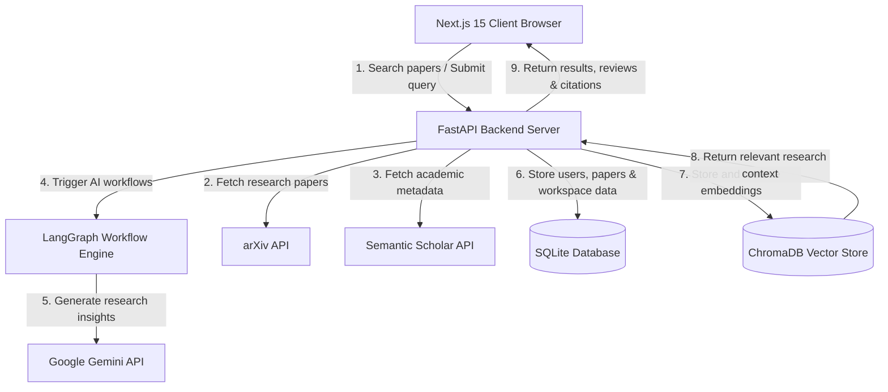
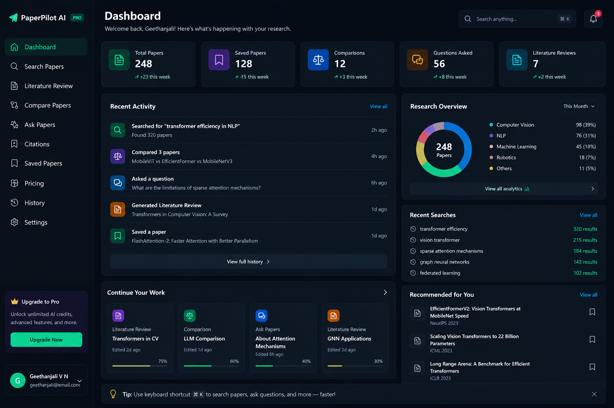
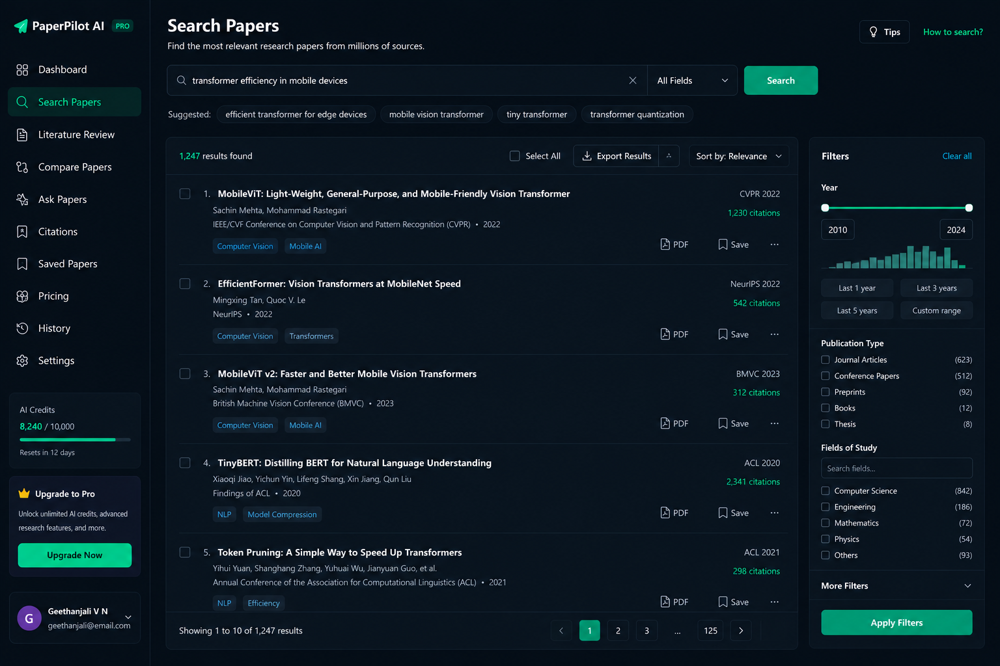
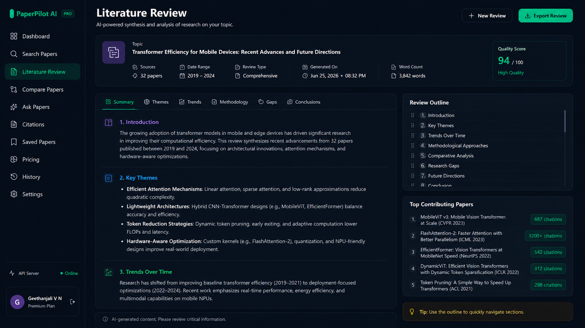
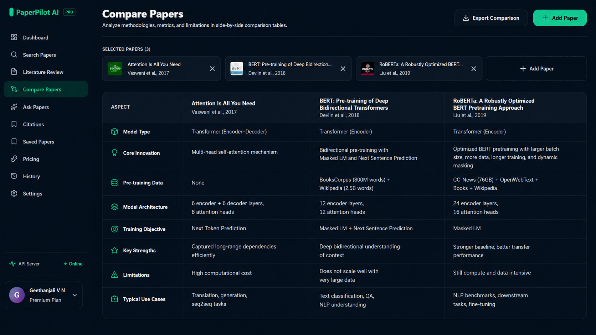
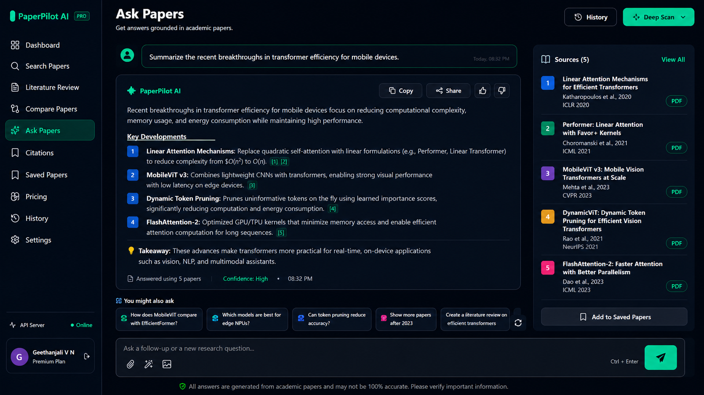
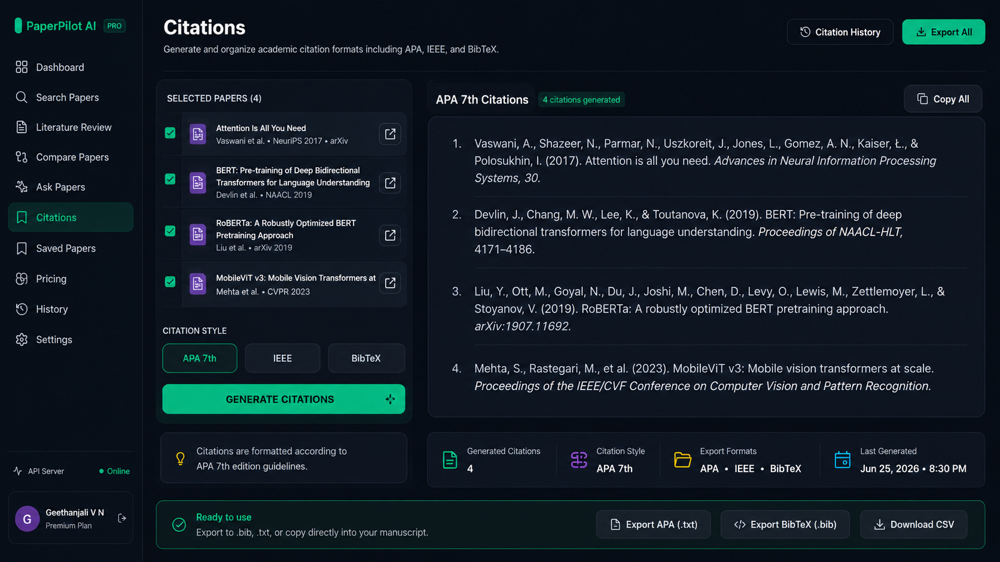
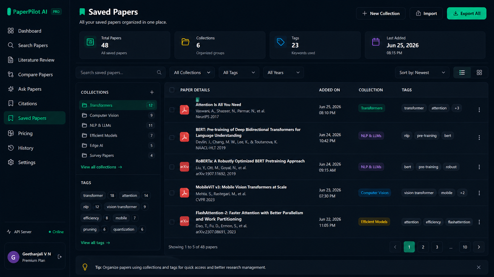
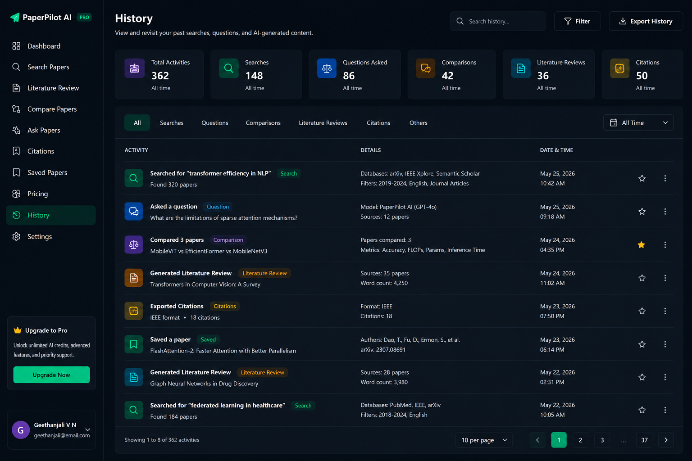

# PaperPilot AI – AI-Powered Research Operating System

**Discover, analyze, compare, and understand academic research papers with AI.**

PaperPilot AI is an AI-powered research platform designed to simplify academic research. It brings academic paper discovery, literature reviews, paper comparison, citation management, and AI-assisted research into one unified workspace.

Built with **Next.js, FastAPI, Gemini, LangGraph, and ChromaDB**, PaperPilot AI helps researchers move from searching for papers to understanding and organizing research insights.

---

## Architecture

The following diagram illustrates the high-level architecture and flow of PaperPilot AI.



---

## Key Features

### 1. Multi-Source Academic Search
- Search academic papers from arXiv and Semantic Scholar.
- Unified research discovery interface.
- Search filtering and relevance-based ranking.
- Paper metadata and publication details.
- Pagination and infinite scrolling.

### 2. AI-Powered Literature Reviews
- Generate structured literature reviews.
- Organize research into:
  - Introduction
  - Methodology
  - Key Findings
  - Future Research Directions
- Citation-aware AI-generated content.
- Export reviews in Markdown and PDF formats.

### 3. Research Paper Comparison
Compare multiple academic papers based on:
- Research architectures.
- Methodologies.
- Performance metrics.
- Limitations.
- Future research directions.

Generate structured comparisons and export the results.

### 4. Ask Papers – AI Research Copilot
- Ask questions across multiple research papers.
- Receive AI-generated answers with inline citations.
- Explore research topics through follow-up questions.
- Use Deep Scan for more detailed research exploration.

### 5. Citation Management
Generate and manage citations in multiple formats:

- APA 7
- IEEE
- BibTeX

Additional capabilities:
- Copy formatted citations.
- Export citations.
- Maintain citation history.

### 6. Research Workspace
- Organize papers into collections and folders.
- Add tags to research papers.
- Bookmark important papers.
- Search and manage saved research.

### 7. Research Dashboard
- View research activity.
- Track saved papers and collections.
- Access recent research activity.
- Manage your research workspace.

### 8. Modern User Interface
- Responsive design.
- Dark mode.
- Smooth animations.
- Interactive research dashboard.
- Modern component-based interface.

---

## Technology Stack

| Layer | Technologies |
|---|---|
| Frontend | Next.js 15, TypeScript |
| UI & Styling | Tailwind CSS, Framer Motion |
| State Management | Zustand |
| Data Fetching | React Query, Axios |
| Backend | Python, FastAPI |
| Database | SQLite, SQLAlchemy |
| Vector Database | ChromaDB |
| AI Integration | Google Gemini API |
| AI Workflow | LangGraph |
| Research Sources | arXiv API, Semantic Scholar API |
| Validation | Pydantic |
| HTTP Client | HTTPX |
| Server | Uvicorn |

---

## Project Structure

```text
PaperPilot-AI/
│
├── backend/
│   ├── app/
│   │   ├── api/
│   │   ├── core/
│   │   ├── models/
│   │   ├── services/
│   │   ├── db/
│   │   └── main.py
│   │
│   ├── tests/
│   └── requirements.txt
│
├── frontend/
│   ├── src/
│   │   ├── app/
│   │   ├── components/
│   │   ├── hooks/
│   │   ├── store/
│   │   ├── lib/
│   │   └── types/
│   │
│   └── package.json
│
├── docs/
│   └── screenshots/
│
├── .gitignore
├── LICENSE
└── README.md
```

---

## Getting Started

Follow these instructions to run PaperPilot AI locally.

### Prerequisites

Make sure you have installed:

- Python 3.11+
- Node.js and npm
- Git
- Google Gemini API key

### 1. Clone the Repository

```bash
git clone https://github.com/Geethanjaliii/PaperPilot-AI.git

cd PaperPilot-AI
```

### 2. Backend Setup

Navigate to the backend directory:

```bash
cd backend
```

Create a virtual environment:

```bash
python -m venv venv
```

Activate the environment.

**Windows:**

```bash
venv\Scripts\activate
```

**macOS / Linux:**

```bash
source venv/bin/activate
```

Install dependencies:

```bash
pip install -r requirements.txt
```

### 3. Configure Environment Variables

Create a `.env` file in the backend directory:

```env
GEMINI_API_KEY=your_gemini_api_key
DATABASE_URL=your_database_url
ENVIRONMENT=development
```

Replace the placeholder values with your actual configuration.

### 4. Start the Backend Server

```bash
uvicorn app.main:app --reload
```

Backend API:

```text
http://localhost:8000
```

### 5. Frontend Setup

Open another terminal and navigate to the frontend directory:

```bash
cd frontend
```

Install dependencies:

```bash
npm install
```

Create a `.env.local` file:

```env
NEXT_PUBLIC_API_URL=http://localhost:8000
```

Start the development server:

```bash
npm run dev
```

Open the application:

```text
http://localhost:3000
```

---

## API Endpoints

The backend exposes REST API endpoints for the application's main research operations.

| Method | Endpoint | Description |
|---|---|---|
| GET | `/health` | Backend health check |
| POST | `/api/v1/search` | Search academic papers |
| POST | `/api/v1/review` | Generate literature reviews |
| POST | `/api/v1/compare` | Compare research papers |
| POST | `/api/v1/query` | Ask questions about papers |
| POST | `/api/v1/citations` | Generate formatted citations |
| GET | `/api/v1/papers` | Retrieve research papers |

---

## Screenshots

The following screenshots showcase the application's interface and major features.

| Dashboard | Research Search |
|---|---|
|  |  |

| Literature Review | Paper Comparison |
|---|---|
|  |  |

| Papers | Citation Management |
|---|---|
|  |  |

| Saved Research | Research History |
|---|---|
|  |  |

---

## Testing

### Backend

Run backend tests using:

```bash
pytest
```

### Frontend

Build the frontend:

```bash
npm run build
```

---

## Deployment

Potential deployment platforms:

| Component | Platforms |
|---|---|
| Frontend | Vercel, Netlify, AWS Amplify |
| Backend | Railway, Render, Google Cloud Run, AWS ECS |

Deployment requires configuring the appropriate environment variables and production database settings.

---

## Future Enhancements

Potential improvements to extend the platform include:

- PDF upload and document parsing.
- Advanced research knowledge graphs.
- Citation network visualization.
- Expanded multi-agent research workflows.
- Collaborative research workspaces.
- Research timeline visualization.
- Personalized paper recommendations.
- Redis-based caching.
- Docker Compose support.
- Kubernetes deployment.
- CI/CD automation.

---

## Author

**Geethanjali V N**

Computer Science and Engineering

GitHub: [@Geethanjaliii](https://github.com/Geethanjaliii)

Project: [PaperPilot AI](https://github.com/Geethanjaliii/PaperPilot-AI)

---

## License

This project is licensed under the **MIT License**.

See the [LICENSE](LICENSE) file for details.

---

<p align="center">
  <b>PaperPilot AI</b><br/>
  Making academic research smarter, faster, and more accessible.
</p>
